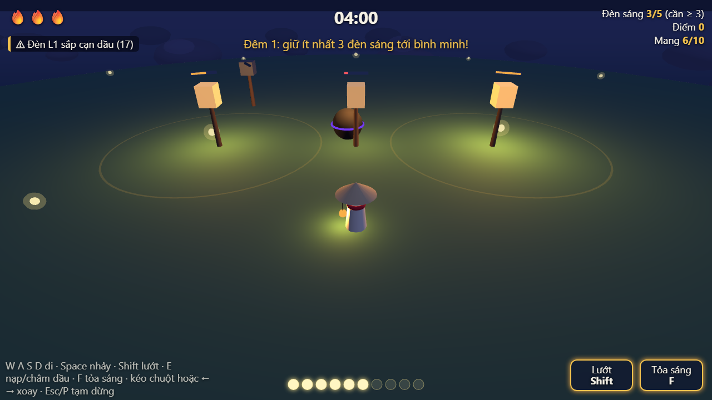
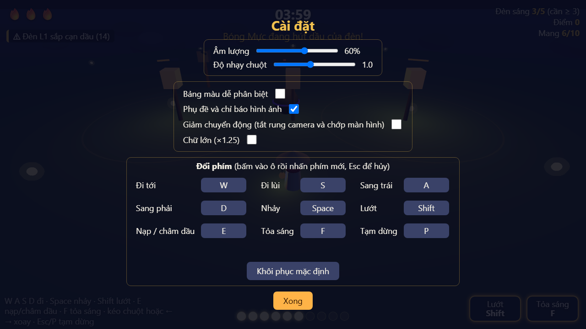

# Đảo Đèn Lồng

> **Video demo (2 phút 11 giây):** [docs/demo/demo.mp4](https://github.com/Letruong238/K5-L3A-LAB-Day12-LeQuangTruong-2A202603663-AI-SDLC-Dao-Den-Long/raw/main/docs/demo/demo.mp4)
> Bài lab Day 12 AI SDLC, cá nhân. Tác giả: Lê Quang Trường (2A202603663). Đề bài gốc của lab: [docs/LAB-README.md](docs/LAB-README.md).



Game 3D góc nhìn thứ ba. **Mây**, người giữ đèn nhỏ tuổi đội nón lá, chạy khắp các hòn đảo trong sương đen, gom **đom đóm**, thắp và **châm dầu** cho **Đèn Lồng Lớn**, né hoặc xua **Bóng Mực** (chúng hút dầu của đèn yếu), và cảnh giác với **Gió Lạc** hay cướp đom đóm. Mục tiêu mỗi đêm: **giữ đảo sáng tới bình minh**.

Phiên bản: **v1.0.0** (Phase 4, Contract v1.3). Lịch sử thay đổi: [CHANGELOG.md](CHANGELOG.md).

## Yêu cầu hệ thống

- Node.js 20 trở lên (đã thử với v24), chạy được trên Windows, macOS, Linux.
- Trình duyệt hiện đại có WebGL (Chrome, Edge, Firefox) để chơi. Lệnh `bench` cần Chrome hoặc Edge.
- Cấu hình đã đo: Intel Core i5-12500H, Iris Xe, 16 GB RAM, Windows 11 (xem phần Hiệu năng).

## Cài đặt và chạy (tối đa 3 lệnh)

```bash
npm install     # cài Three.js
npm start       # chạy server, mở http://localhost:5173 trên trình duyệt
npm test        # chạy toàn bộ test
```

Không muốn cài gì thêm? Tải gói `dao-den-long-v1.0.0.zip` ở trang Release, giải nén, chạy `node server.js` rồi mở http://localhost:5173.

Mở thẳng một đêm (bỏ qua menu): http://localhost:5173/?night=2 · Bấm F3 trong game để hiện FPS.

## Điều khiển

Mặc định như bảng dưới; **mọi phím trừ Esc, Enter, mũi tên, F3 đều đổi được** trong Cài đặt (xem phần Tiếp cận).

| Phím | Việc |
|---|---|
| W A S D | Đi (theo hướng camera) |
| Space | Nhảy (chỉ khi đang đứng đất) |
| Shift | Lướt 14 m/s trong 0.2 s (hồi 1.5 s) |
| E | Nạp đom đóm vào đèn gần nhất chưa sáng, hoặc **châm dầu** cho đèn đang sáng (đứng trong 2 m) |
| F | Tỏa sáng, xua Bóng Mực và Gió Lạc (tốn 3 đom đóm, hồi 3 s) |
| Kéo chuột, hoặc ← → | Xoay camera |
| P hoặc Esc | Tạm dừng |
| Enter | Vào đêm ở màn giới thiệu |

## Luật chơi

- **Mục tiêu:** còn sống tới bình minh (hết giờ) và còn ít nhất `ceil(0.6 × tổng)` đèn **đang sáng**: Đêm 1 cần 3/5, Đêm 2 cần 4/6, Đêm 3 cần 5/7. Thắp đủ đèn **không** kết thúc đêm. Thời gian 240 / 270 / 300 s.
- **Đèn có dầu (tối đa 100):** thắp xong dầu đầy 100, hao 1 dầu mỗi giây. Hết dầu thì đèn tắt (nhớ là đã từng sáng). Bấm E ở đèn đang sáng để **châm dầu**: mỗi đom đóm cho +10 dầu.
- **Thắp:** đèn chưa từng sáng cần 10 đom đóm; **thắp lại** đèn đã từng sáng chỉ cần 5. Nạp từng ít một được, đèn nhớ tiến độ.
- **Vùng an toàn 6 m** chỉ có ở đèn sáng có dầu **từ 30 trở lên**. Dưới 30 thì đèn nhấp nháy chậm và mất vùng an toàn.
- **Bóng Mực hút dầu:** Bóng Mực đang lang thang sẽ đi tới đèn yếu (dầu dưới 30), đứng yên hút 5 dầu/giây (nhiều con thì cộng dồn). Mây lại gần trong 6 m thì chúng quay sang đuổi. Châm dầu lên từ 30 trở lên thì chúng bị đẩy ra và không gây sát thương.
- **Sức chứa tăng dần:** `10 + 2 × số lần thắp thành công trong đêm` (kể cả thắp lại), tối đa 20.
- Bóng Mực phát hiện Mây ở 12 m, bỏ đuổi ở 18 m. Chạm thì mất 1 ngọn lửa (có 3), rơi một nửa số đom đóm đang mang, bất tử 1.5 s.
- **Đêm 1 – Đảo Bến.** **Đêm 2 – Đảo Cau:** hai đảo nối cầu tre, bục nhảy, Gió Lạc, Bùa Gió. **Đêm 3 – Đảo Chuông:** ba tầng, dốc, bục nhảy, tháp chuông, gió mạnh mỗi 30 s.
- **Rơi khỏi đảo:** mất 1 lửa và toàn bộ đom đóm, chờ 1 s rồi hồi sinh. **Thua:** hết lửa (luôn ưu tiên, kể cả ở tick bình minh), hoặc bình minh mà thiếu đèn sáng.

| Sự kiện | Điểm |
|---|---|
| Mỗi đom đóm nạp hoặc châm vào đèn | +5 |
| Thắp lần đầu | +100 |
| Thắp lại | +40 |
| Bóng Mực trúng Tỏa Sáng | +5 (+15 nếu đang hút dầu) |
| Bình minh (chỉ khi thắng): mỗi đèn đang sáng | +50 + phần nguyên của dầu |
| Bình minh (chỉ khi thắng): mỗi ngọn lửa còn lại | +50 |

Tổng điểm game là tổng điểm các đêm đã thắng. Số liệu chuẩn: [src/core/tuning.js](src/core/tuning.js), khai trong [game.contract.json](game.contract.json) (test bắt buộc hai nơi khớp nhau). Bản đồ: [src/core/maps.js](src/core/maps.js).

## Bảng xếp hạng

Sau màn **Bình Minh** (thắng Đêm 3) hoặc khi **thua ở bất kỳ đêm nào**, nhập tên để lưu điểm:

- Tên 3 đến 12 ký tự: chữ cái, số, dấu gạch dưới `_` (`[A-Za-z0-9_]`; chữ tiếng Việt có dấu cũng được). Không có dấu cách.
- Mỗi mục lưu `name`, `score` (tổng điểm các đêm đã thắng), `nights_won` (0 đến 3), `achieved_at` (ISO 8601 kèm múi giờ), `seed`.
- Giữ top 10, điểm giảm dần, bằng điểm thì ai đạt trước đứng trên.
- Lưu trên đĩa ở `data/leaderboard.json` (không commit), còn nguyên sau khi tắt và mở lại game. Xem từ nút **Bảng xếp hạng** ở menu.
- Xuất ra file: `npm start -- --export-leaderboard out.json` cho `{"entries": [...]}` đúng thứ tự (lệnh này không bật server).

## Tiếp cận (accessibility)

Mở **Cài đặt** từ menu hoặc màn tạm dừng:

- **Đổi phím** cho 9 hành động (4 hướng, nhảy, lướt, nạp/châm dầu, tỏa sáng, tạm dừng). Gán trùng phím thì báo lỗi và giữ phím cũ; có nút **Khôi phục mặc định**; được lưu.
- **Phụ đề và chỉ báo hình ảnh:** chữ thông báo khi Bóng Mực xuất hiện (kèm mũi tên ở mép màn hình chỉ hướng), gió sắp thổi, 10 giây cuối, đèn có dầu dưới 30.
- **Giảm chuyển động:** tắt rung camera và chớp màn hình (mặc định theo cài đặt của hệ điều hành).
- **Chữ UI:** tối thiểu 18 px ở 1280×720; tùy chọn **Chữ lớn (×1.25)**.
- **Bảng màu dễ phân biệt:** viền Bóng Mực xanh dương #00B3FF, cảnh báo màu trắng kèm ⚠; đèn tắt xẹp và có vết rách.



## Chế độ headless (Test Contract v1.3)

Chạy logic game không cần cửa sổ, 60 tick/giây, in ra JSONL:

```bash
node src/headless/cli.js --seed 1 --night 2 --ticks 600 --out out.jsonl
node src/headless/cli.js --seed 1 --night 3 --scenario s.json --inputs i.json --ticks 600 --snapshot-every 10 --out out.jsonl
```

`--night` nhận 1, 2, 3. Mã thoát: `0` thành công, `2` file scenario/inputs sai định dạng, `1` lỗi khác (lỗi ghi ra stderr). Cùng seed, scenario và inputs luôn cho output giống hệt nhau từng byte. Một đêm đầy đủ chạy dưới 1 giây. Phase 4 **không đổi** đầu ra headless.

## Benchmark và soak test

```bash
npm run bench     # = node scripts/bench.mjs --seed 42 --duration 30 --out bench.json
npm run soak      # = node scripts/soak.mjs --seed 7 --nights 10 --out soak.json
```

**Benchmark** mở bản web trong Chrome (cửa sổ 1280×720, không toàn màn hình, tắt vsync bằng `--disable-gpu-vsync --disable-frame-rate-limit`) với cảnh chuẩn: Đêm 1, 200 Bóng Mực wander, 100 đom đóm, L1 đến L3 sáng fuel 100, Mây đứng yên ở (0,0,0), camera bay vòng bán kính 30 m, cao 15 m, 15 s một vòng. 3 s đầu khởi động, rồi đo 30 s và thoát mã 0. Cần Chrome hoặc Edge (đặt `CHROME_PATH` nếu không tự tìm thấy). Nếu cửa sổ ngừng vẽ giữa chừng, script tự chạy lại bằng Chrome ngầm (vẫn GPU thật) và ghi chế độ vào trường `renderer`. `peak_mem_mb` là tổng bộ nhớ làm việc của mọi tiến trình Chrome (cao hơn RSS thật một chút).

**Soak** chạy 10 đêm liên tiếp trong một tiến trình (Đêm 1, 2, 3 xoay vòng, đêm thứ i dùng seed 7 + i), input ngẫu nhiên theo seed, đếm crash và bộ nhớ.

Số đo trên máy phát triển (Intel i5-12500H, Iris Xe, 16 GB, Windows 11, Chrome 157, chế độ cửa sổ):

| Chỉ số | Kết quả | Ngưỡng |
|---|---|---|
| `avg_fps` | 326.7 | ≥ 60 |
| `p1_low_fps` | 185.1 | ≥ 30 |
| `frame_ms_p95` | 4.4 ms | - |
| `load_ms` | 502 ms | ≤ 10000 |
| `peak_mem_mb` | 703.4 | - |
| Soak: crashes | 0 | = 0 |
| Soak: bộ nhớ | ≈ 49 → ≈ 50 MB (≈ 1.02×, số chính xác trong soak.json) | ≤ 1.2× |

File gốc: [docs/proof/phase4/bench.json](docs/proof/phase4/bench.json), [soak.json](docs/proof/phase4/soak.json). Đây là số trên máy của tác giả; **máy chấm của giảng viên sẽ cho số khác**. Cách đo soak (có khởi động nóng) và các giả định ở [phase4-spec.md](docs/notes/phase4-spec.md).

## Kiểm chứng

- `npm test`: test đơn vị và scenario cho mọi tiêu chí của cả 4 phase, kiểm tra tất định cả 3 đêm, mã thoát, khớp contract, bảng xếp hạng, đổi phím, benchmark, soak, cỡ chữ.
- `npm run proof`: chạy lệnh thật (headless, soak, xuất bảng xếp hạng) và ghi vào [docs/proof/phase4/RESULTS.md](docs/proof/phase4/RESULTS.md). Bằng chứng các phase trước (khớp tag tương ứng) vẫn ở [phase1](docs/proof/phase1/RESULTS.md), [phase2](docs/proof/phase2/RESULTS.md), [phase3](docs/proof/phase3/RESULTS.md).
- Ảnh chụp bản web: [docs/proof/phase4/](docs/proof/phase4/) (`web-*.png`).
- CI (GitHub Actions) chạy `npm ci`, `npm test`, `npm run proof` mỗi lần push.
- Đóng gói bản phát hành: `npm run dist` tạo `dist/dao-den-long-v1.0.0.zip`.
- Tài liệu: [spec Phase 4](docs/notes/phase4-spec.md) · [nhật ký Phase 4](docs/notes/phase4-log.md) · [retro](docs/RETRO.md) · [ADR-001](docs/notes/ADR-001-den-co-dau-va-luat-thang.md) · [Phase 3](docs/notes/phase3-spec.md) · [Phase 2](docs/notes/phase2-spec.md) · [Phase 1](docs/notes/phase1-assumptions.md).

## Sáng tạo của tôi

- **Biển mây trôi** quanh đảo và **đom đóm lấp lánh** (chỉ ở bản web, trong `web/main.js`; tắt trong benchmark).
- Đèn sáng dần theo lượng dầu, thanh dầu trên mỗi đèn; ánh sáng môi trường và sương đổi theo số đèn sáng.
- **Ông Đăng** nói một câu mở đầu mỗi đêm (màn giới thiệu).
- Phụ đề, mũi tên chỉ hướng Bóng Mực, rung camera và chớp màn hình khi bị trúng (tắt được).
- Các phần này không nằm trong `src/core/`, nên đầu ra headless không đổi.

## Giới hạn đã biết (nói thật)

- **Chưa chơi tay đủ 3 đêm.** Đã kiểm tra: server chạy, ảnh chụp bằng Chrome chạy ngầm thấy HUD, phụ đề, Cài đặt (đổi phím), Bảng xếp hạng, chữ lớn, bảng màu dễ phân biệt. Luồng menu → giới thiệu → kết quả → nhập tên → Bình Minh, âm thanh, rung camera, chớp màn hình **chỉ mới được viết và kiểm bằng test/ảnh, chưa ai chơi thử tận tay**; nhấp nháy 1 Hz chưa nhìn tận mắt.
- **Chưa có bằng chứng người hoặc bot thắng trọn vẹn một đêm** với luật Phase 3 (soak dùng bot ngẫu nhiên nên cả 10 đêm đều thua; nó chỉ kiểm độ ổn định). Rủi ro cân bằng: chưa biết đêm có quá khó không.
- **Benchmark mới đo trên một máy.** Chế độ cửa sổ của Chrome thỉnh thoảng ngừng vẽ giữa chừng (chưa rõ nguyên nhân gốc, đã gặp 6 trong khoảng 13 lần thử; ba lần chạy liên tiếp cuối cùng đều ổn); script có canh chừng và tự chạy lại bằng chế độ ngầm, ghi rõ vào `renderer`.
- **Soak:** mốc bộ nhớ đầu lấy sau một lượt khởi động nóng (lý do: engine JS biên dịch mã nóng làm RSS vọt lên một lần, đã chứng minh heap phẳng qua 1000 đêm). Nếu tính nghiêm ngặt mốc đầu lúc mới tải thì tỉ lệ ≈ 1.25×, vượt ngưỡng; xem [phase4-spec.md](docs/notes/phase4-spec.md).
- Bản phát hành là gói zip web + `server.js` (cần Node), không có file thực thi riêng hay Docker.
- Âm thanh là âm tổng hợp bằng WebAudio, chưa cân chỉnh.
- Một số chỗ ticket chưa nói rõ đã tự giả định: [phase2-spec.md](docs/notes/phase2-spec.md) (H1 đến H19), [phase3-spec.md](docs/notes/phase3-spec.md) (I1 đến I14), [phase4-spec.md](docs/notes/phase4-spec.md) (J1 đến J16).

## Cấu trúc

```text
src/core/        luật chơi thuần (chạy headless được): game, bản đồ, số liệu chuẩn, kiểm tra định dạng,
                 bảng xếp hạng, cảnh benchmark, soak
src/headless/    lệnh headless, lưu bảng xếp hạng ra đĩa
web/, server.js  bản 3D Three.js (cảnh, âm thanh, HUD, menu, đổi phím) và server (API bảng xếp hạng)
scripts/         proof.mjs (bằng chứng), bench.mjs, soak.mjs, dist.mjs (đóng gói)
tests/           test đơn vị và scenario
docs/notes, docs/proof  giả định, ADR, nhật ký, retro, bằng chứng
CHANGELOG.md, CREDITS.md, LICENSE
CLAUDE.md, .claude/   harness AI (hướng dẫn, hook, skill)
```
